# 01 — Visão de produto, públicos e MVP

> **Status:** Fase 1 (Descoberta) — documento vivo.
> **Fonte de referência:** o texto recebido foi o *Adendo Técnico — Comissões, Recompensas, Liquidação Financeira e Integração VTEX* e o briefing do projeto. **O documento principal da ideia (citado como "documento anexo") não foi recebido** — apenas o adendo. Tudo o que vem do briefing/adendo está marcado como **[Definido]**; o que é inferência ou recomendação está marcado como **[Recomendação]** e precisa de validação; o que depende de terceiros está marcado como **[Pendente]**.

---

## 1. Resumo da ideia e proposta de valor

**A ideia [Definido]:** uma plataforma em que usuárias descobrem produtos de moda de marcas parceiras, montam *looks* combinando peças, publicam esses looks em uma URL própria e os compartilham (redes sociais, WhatsApp etc.). Quando alguém compra uma peça a partir de um look, a venda é atribuída à usuária autora, a marca paga comissão à plataforma e parte dessa comissão vira **recompensa** resgatável pela usuária.

**Primeira marca [Definido]:** Suntime (loja em VTEX), com comissão comercial informada de **25%** — sujeita a contrato e à confirmação da base de cálculo. Divisão pretendida: **20 p.p. para a usuária / 5 p.p. para a plataforma** — premissa comercial, parametrizável, não fixa no código.

### Proposta de valor por lado

| Lado | Valor entregue |
|---|---|
| **Usuária criadora** | Ferramenta simples para montar looks bonitos com peças reais, uma página compartilhável e **recompensa financeira transparente** pelas vendas que gerar. |
| **Visitante / compradora** | Inspiração curada por pessoas reais, looks completos "prontos para comprar", com link direto ao produto correto na loja. |
| **Marca parceira** | Canal de aquisição baseado em performance (paga por venda validada, não por exposição), conteúdo gerado por usuárias e dados de desempenho por produto/look. |
| **Plataforma** | Receita de margem (diferença entre comissão recebida e recompensa repassada), base de criadoras e dados de tendência. |

**Diferencial central:** o *look* (conjunto de peças) como unidade de compartilhamento e atribuição — não o link de produto isolado, como nos programas de afiliados tradicionais.

---

## 2. Mapa de perfis de usuários

| Perfil | Quem é | Necessidades | Objetivos | Autenticação |
|---|---|---|---|---|
| **Visitante** (não autenticado) | Quem recebe um link de look ou chega pelo site | Ver looks, ver peças, ir à loja com segurança | Inspirar-se e comprar | Não |
| **Usuária cadastrada** (criadora) | Consumidora/influenciadora de qualquer porte | Catálogo fácil, montador rápido no celular, link bonito para compartilhar, ver cliques/vendas/recompensas, resgatar | Ganhar recompensas e reconhecimento | Sim |
| **Administrador(a)** | Sócias/equipe central | Visão total da operação, financeiro, configurações, aprovações críticas | Operar e auditar o negócio | Sim + MFA obrigatório |
| **Operador(a) administrativo(a)** | Equipe de suporte/curadoria/financeiro júnior | Moderar looks, gerir produtos, atender usuárias, preparar (não aprovar) pagamentos | Executar rotinas com privilégio mínimo | Sim + MFA obrigatório |
| **Representante de marca** | Equipe da Suntime e futuras marcas | Ver desempenho, catálogo, faturas/comissões da **própria** marca | Medir retorno do canal | Sim + MFA recomendado — **pós-MVP** [Recomendação] |
| **Sistema / integrações** | Jobs, webhooks VTEX, importador de feed | Credenciais de máquina com escopo mínimo | Sincronizar dados | Tokens de serviço |

**Recomendação sobre o portal da marca:** no MVP há uma única marca e o relacionamento é próximo; relatórios podem ser exportados pelo admin e enviados. O portal self-service de marcas entra quando houver a 2ª–3ª marca. O **modelo de dados já nasce multi-marca**, para não exigir migração.

---

## 3. Como a plataforma funciona na prática

```mermaid
flowchart LR
  A[Importação do feed XML da marca] --> B[Catálogo]
  B --> C[Usuária monta look]
  C --> D[Publica: URL própria /l/slug]
  D --> E[Compartilha WhatsApp/Instagram]
  E --> F[Visitante abre o look]
  F --> G[Clica numa peça: /r/clickId]
  G --> H[Redirect p/ loja VTEX com identificador de origem]
  H --> I[Compra na loja]
  I --> J[Integração VTEX recupera pedido + identificador]
  J --> K[Conversão atribuída]
  K --> L[Validação: prazo + status do pedido]
  L --> M[Comissão calculada / cobrada / recebida]
  L --> N[Recompensa pendente → elegível]
  N --> O[Resgate solicitado → aprovado → pago]
```

1. **Catálogo:** produtos entram pelo feed XML da marca (formato a confirmar — provavelmente feed de produtos estilo Google Shopping) e são normalizados.
2. **Montagem:** a usuária busca/filtra, adiciona peças ao look, ordena, dá título/descrição, escolhe capa (colagem automática).
3. **Publicação:** o look ganha slug e URL pública, com metadados Open Graph (prévia no WhatsApp/Instagram).
4. **Clique rastreável:** cada clique de saída passa por um redirecionador próprio que grava um `click_id` (usuária, look, produto, campanha) e envia a visitante à loja com o identificador.
5. **Atribuição:** a integração lê os pedidos da VTEX e tenta relacioná-los ao `click_id`. **Sem evidência, não há atribuição.**
6. **Financeiro:** a conversão gera lançamentos no **livro-razão** (comissão estimada, recompensa pendente). Mudanças de status geram novos lançamentos (nunca edição de saldo).
7. **Resgate:** recompensa elegível pode ser solicitada; um admin aprova; o pagamento (PIX, a definir) é registrado com comprovante.

---

## 4. Principais recursos, regras de negócio e dependências técnicas

### Regras de negócio (já explícitas no briefing/adendo) [Definido]
- R1. Percentuais de comissão e divisão **configuráveis por marca e campanha**, com **vigência**; vendas já realizadas preservam a regra vigente no momento da conversão (*snapshot* da regra no lançamento).
- R2. Estados distintos: clique → venda atribuída → pedido registrado → venda validada → comissão calculada → cobrada → recebida; recompensa pendente → elegível → resgate solicitado → paga; cancelamentos/devoluções/estornos.
- R3. Livro-razão imutável com referência ao evento de origem; ajustes sempre com motivo.
- R4. Idempotência: evento repetido não duplica pedido, comissão ou recompensa.
- R5. 30 dias para resgate — **marco inicial e condições a validar juridicamente**; o tempo sozinho não libera se houver pendência.
- R6. Valores devidos às usuárias não são receita livre da plataforma.
- R7. Atribuição só com evidência comprovada em teste E2E; não simular pedidos/pagamentos.
- R8. Catálogo, montador e páginas compartilháveis **não** ficam bloqueados pela integração financeira.

### Regras recomendadas [Recomendação — validar]
- Janela de atribuição (ex.: clique válido por 7–30 dias) e modelo **último clique**.
- Autocompra (usuária comprando pelo próprio look) — permitir ou não? Afeta fraude e custo.
- Valor mínimo para resgate (ex.: R$ 20) para reduzir custo operacional de PIX.
- Itens com desconto/cupom: base de cálculo = valor efetivamente pago pelo item, sem frete — **depende do contrato**.
- Moderação: looks publicados ficam visíveis imediatamente, com denúncia e despublicação pelo operador (moderação *a posteriori*).

### Dependências técnicas
| Dependência | Para quê | Bloqueia |
|---|---|---|
| Feed XML real da Suntime | Catálogo | Fase 4 (pode iniciar com dados fictícios) |
| Acesso VTEX (AppKey/AppToken com perfil mínimo de leitura de pedidos) + ambiente de testes | Sincronizar pedidos | Fase 7 |
| Mecanismo de preservação do identificador na VTEX | Atribuição | Recompensas reais |
| Contrato com base de cálculo e regras de cancelamento | Cálculo de comissão | Operação financeira real |
| Meio de pagamento às usuárias (PIX via PSP) | Resgates | Pagamentos reais |
| Parecer jurídico/contábil/tributário | Termos, retenções, natureza da recompensa | Lançamento |

---

## 5. Requisitos definidos × decisões pendentes

Ver tabela completa em [`06-riscos-e-decisoes.md`](./06-riscos-e-decisoes.md). Resumo:

| Já definido | Ainda precisa ser decidido |
|---|---|
| Suntime como 1ª marca, loja VTEX | Base de cálculo da comissão (bruto? líquido de desconto/frete/impostos?) |
| Comissão informada 25% (sujeita a contrato) | Marco inicial dos 30 dias (data do pedido? faturamento? entrega?) |
| Divisão pretendida 20/5 p.p. | Tratamento de devolução parcial e estorno após resgate |
| Parametrização por marca/campanha | Como a marca paga (fatura, cartão, transferência) e quando |
| Livro-razão imutável e idempotência | Como a recompensa é paga (PIX? crédito? cashback?) e natureza tributária |
| Resgate pretendido após 30 dias | Mecanismo VTEX de atribuição (UTM/marketingData/app de afiliados/cupom) |
| Integração direta com VTEX como caminho preferencial | Janela de atribuição e regra de autocompra |
| Testes E2E obrigatórios antes de recompensas reais | Nome/marca da plataforma, identidade visual final |

---

## 6. Riscos, limitações e oportunidades (resumo)

Detalhado em [`06-riscos-e-decisoes.md`](./06-riscos-e-decisoes.md). Os cinco maiores:

1. **Atribuição não comprovável** na configuração atual da VTEX → sem atribuição não há modelo de negócio. *Mitigação:* auditoria técnica é a primeira tarefa externa; plano B com cupom individual ou app de afiliados.
2. **Risco financeiro de repassar antes de receber** (recompensa paga antes de a marca pagar a comissão, ou estorno após resgate) → *Mitigação:* elegibilidade exige pedido validado **e**, por configuração, comissão recebida; saldo negativo compensável.
3. **Fraude** (autocompra, cliques artificiais, compra-e-devolve) → *Mitigação:* janela de validação, detecção de padrões, limites e revisão manual de resgates.
4. **Enquadramento jurídico/tributário** da recompensa (prestação de serviço? cashback? necessidade de CPF e retenções) → *Mitigação:* parecer antes do lançamento; coleta de CPF apenas no primeiro resgate.
5. **Dependência de uma única marca** → catálogo pequeno limita o valor do montador. *Mitigação:* modelo multi-marca desde o início; pipeline comercial paralelo.

**Oportunidades:** looks como conteúdo indexável (SEO de "look para…"), ranking de criadoras, campanhas sazonais com bônus, dados de combinações de peças valiosos para as marcas.

---

## 7. Proposta de MVP

**Hipóteses a validar com o MVP:**
- H1. Usuárias montam e compartilham looks voluntariamente (métrica: looks publicados/usuária ativa, compartilhamentos).
- H2. Looks compartilhados geram cliques qualificados para a loja (CTR por visualização de look).
- H3. É possível atribuir vendas à usuária/look com confiabilidade na VTEX da Suntime (taxa de pedidos com identificador recuperado nos testes).
- H4. A conversão gera margem positiva após recompensas e custos.

**Escopo do MVP (o mínimo para validar H1–H4):**

| Módulo | No MVP | Fora do MVP |
|---|---|---|
| Site público | Home, como funciona, descobrir looks, página do look, marcas (lista simples), FAQ, termos, privacidade, contato (formulário simples) | Blog, páginas de criadoras ranqueadas |
| Conta | Cadastro e-mail+senha e Google, verificação de e-mail, recuperação, aceite de termos | Login com Apple/Instagram, MFA para usuárias |
| Área da usuária | Dashboard, perfil público básico, catálogo com busca/filtros, detalhe de produto, montador, meus looks, favoritos de produtos, desempenho (cliques/vendas), recompensas/extrato, resgate | Seguidores, comentários, coleções, editor visual livre (canvas) |
| Catálogo | Importação do feed XML (agendada + manual), categorias, disponibilidade e preço | Portal de upload pela marca, vários feeds por marca |
| Afiliados | Redirecionador com `click_id`, atribuição via mecanismo VTEX validado, livro-razão, regras por marca/campanha | Bônus por metas, multinível (não recomendado) |
| Admin | Visão geral, usuárias, marcas/campanhas/regras, produtos/importações, looks (moderação), conversões, livro-razão, resgates, conciliação, logs de integração, auditoria | Construtor de relatórios, permissões customizáveis por tela |
| Portal da marca | **Não** — relatórios exportados pelo admin | Portal completo |

**Princípio:** catálogo + montador + página do look (Fases 2–4) seguem em paralelo à auditoria VTEX (Fase 7a). Recompensas reais só são ligadas depois dos critérios de aceite financeiros.

---

## 8. Visão de evolução

| Versão | Foco | Exemplos |
|---|---|---|
| **MVP (v0.x)** | Validar H1–H4 com Suntime | Escopo acima, operação com volume baixo |
| **v1 — Multi-marca** | Escalar oferta | Portal da marca, onboarding de marcas, múltiplos feeds, outras plataformas (Shopify, Nuvemshop, Tray) via adaptadores, faturamento automático das marcas |
| **v2 — Comunidade** | Retenção e distribuição | Perfis públicos ricos, seguir criadoras, curtidas, coleções, ranking, desafios/campanhas temáticas, notificações push |
| **v3 — Inteligência** | Conversão | Recomendação de peças complementares, busca visual, "complete o look", testes A/B, insights de tendência para marcas (dados agregados/anonimizados) |
| **v4 — Plataforma** | Escala | App nativo/PWA instalável, API pública para marcas, pagamentos em massa automatizados, programa de níveis de criadoras com percentual variável |
