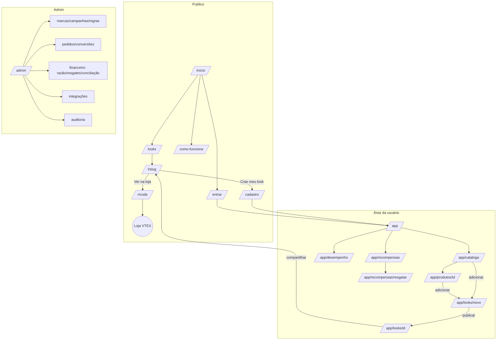
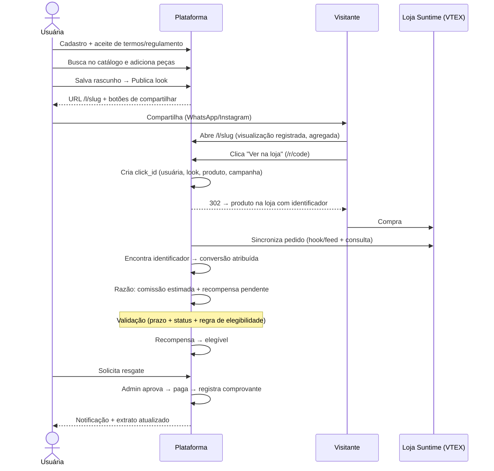
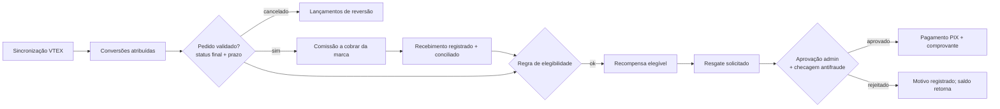

# 02 — Arquitetura funcional, sitemap, fluxos e permissões

## 1. Ambientes da plataforma

| # | Ambiente | Finalidade | Usuários | Permissões-chave | Relação com outros módulos | MVP |
|---|---|---|---|---|---|---|
| A | **Site público** | Apresentar, inspirar, converter em cadastro e em clique para loja | Visitantes, todos | Leitura de conteúdo público | Lê looks publicados, marcas, produtos ativos | ✅ |
| B | **Autenticação** | Cadastro, login, verificação, recuperação, sessões | Todos | Rate limit, bloqueio progressivo | Cria `users`/`profiles`, registra consentimentos | ✅ |
| C | **Área da usuária** (`/app`) | Montar, publicar e acompanhar looks e recompensas | Usuária | Somente dados próprios (escopo `owner`) | Usa catálogo, looks, links, livro-razão | ✅ |
| D | **Catálogo** | Produtos e marcas normalizados e pesquisáveis | Público (leitura), admin (gestão) | Escrita só por importador/admin | Alimenta montador e página do look | ✅ |
| E | **Montador/editor de looks** | Compor looks a partir do catálogo | Usuária | Edita só os próprios looks | Catálogo → Looks → Página pública | ✅ |
| F | **Página pública do look** (`/l/[slug]`) | Compartilhamento e conversão | Visitantes | Somente looks `published` e não removidos | Gera cliques via redirecionador | ✅ |
| G | **Links rastreáveis** (`/r/[code]`) | Registrar clique e redirecionar com identificador | Visitantes (anônimo) | Endpoint público com rate limit e anti-bot | Alimenta atribuição | ✅ |
| H | **Recompensas e extrato** | Transparência financeira e resgates | Usuária | Leitura própria; criar solicitação de resgate | Lê livro-razão; cria `payout_requests` | ✅ |
| I | **Painel administrativo** (`/admin`) | Operar o negócio sem SQL manual | Admin, operador | RBAC granular, MFA, auditoria | Lê/escreve todos os módulos via serviços | ✅ |
| J | **Portal da marca** (`/marca`) | Self-service para marcas | Representante de marca | Escopo restrito à própria marca | Lê catálogo/vendas/faturas da marca | ❌ (v1) |
| K | **Relatórios e monitoramento** | Indicadores, saúde de integrações, alertas | Admin (+ marca no v1) | Exportação só com permissão `reports.export` | Lê dados agregados, logs, filas | ✅ (básico) |

---

## 2. Sitemap e hierarquia de páginas

Legenda: ✅ MVP · 🔜 pós-MVP · 🔒 autenticado · 🛡️ admin

### A. Site público
| Rota | Página | Objetivo | MVP |
|---|---|---|---|
| `/` | Início | Explicar a proposta em 5 s, mostrar looks em destaque, CTAs "Explorar looks" e "Criar meu look" | ✅ |
| `/como-funciona` | Como funciona | Passo a passo (montar → compartilhar → ganhar) e **regras claras de recompensa** | ✅ |
| `/looks` | Descobrir looks | Feed/grade de looks publicados com filtros (ocasião, estilo, marca, faixa de preço) | ✅ |
| `/l/[slug]` | Look público | Mostrar o look, peças, preços, botão "Ver na loja" por peça; OG tags | ✅ |
| `/r/[code]` | Redirecionador (sem UI) | Registrar clique e redirecionar | ✅ |
| `/marcas` | Marcas parceiras | Lista de marcas ativas | ✅ |
| `/marcas/[slug]` | Página da marca | Sobre a marca, looks com peças dela | 🔜 (MVP: simples) |
| `/@[username]` | Perfil público da criadora | Bio e looks publicados | ✅ (simples) |
| `/faq` | Perguntas frequentes | Reduzir dúvidas sobre recompensas e prazos | ✅ |
| `/contato` | Contato | Formulário (assunto, e-mail, mensagem) | ✅ |
| `/termos` | Termos de uso | Inclui regulamento do programa de recompensas (versão vigente) | ✅ |
| `/privacidade` | Política de privacidade | LGPD, direitos do titular, canal do encarregado | ✅ |
| `/regulamento` | Regulamento de recompensas | Versionado; aceito no cadastro e reaceito quando muda | ✅ |
| `/para-marcas` | Seja uma marca parceira | Captação comercial | 🔜 |

### B. Autenticação
| Rota | Página | MVP |
|---|---|---|
| `/entrar` | Login (e-mail+senha, Google) | ✅ |
| `/cadastro` | Cadastro (nome, e-mail, senha, aceite de termos/regulamento, idade ≥ 18) | ✅ |
| `/verificar-email` | Confirmação de e-mail | ✅ |
| `/recuperar-senha` · `/redefinir-senha` | Recuperação por link de uso único (expira em 30 min) | ✅ |

### C. Área da usuária (🔒 `/app`)
| Rota | Página | Objetivo | MVP |
|---|---|---|---|
| `/app` | Dashboard | Resumo: looks, cliques 30d, vendas atribuídas, recompensa pendente/elegível, atalhos | ✅ |
| `/app/catalogo` | Catálogo | Busca, filtros (categoria, marca, cor, tamanho, preço, disponível), ordenação; "adicionar ao look" | ✅ |
| `/app/produtos/[id]` | Detalhe do produto | Imagens, preço, variações, disponibilidade, "adicionar ao look", favoritar | ✅ |
| `/app/looks` | Meus looks | Lista por estado (rascunho, publicado, despublicado), métricas por look | ✅ |
| `/app/looks/novo` · `/app/looks/[id]/editar` | Montador | Compor, reordenar, pré-visualizar, salvar, publicar | ✅ |
| `/app/looks/[id]` | Detalhe/desempenho do look | Cliques por peça, vendas, compartilhar | ✅ |
| `/app/favoritos` | Favoritos | Produtos salvos para usar depois | ✅ |
| `/app/desempenho` | Cliques e vendas | Cliques, conversões atribuídas e seus estados (sem dados pessoais da compradora) | ✅ |
| `/app/recompensas` | Recompensas e extrato | Saldos por estado + extrato do livro-razão | ✅ |
| `/app/recompensas/resgatar` | Solicitar resgate | Dados de recebimento (chave PIX, CPF na 1ª vez), confirmação | ✅ |
| `/app/perfil` | Perfil | Nome, @username, foto, bio, redes | ✅ |
| `/app/configuracoes` | Conta e privacidade | Senha, sessões ativas, notificações, exportar dados, excluir conta | ✅ |
| `/app/preferencias` | Preferências de estilo | Tamanhos, estilos (para recomendações) | 🔜 |

### D. Painel administrativo (🛡️ `/admin`)
| Rota | Página | MVP |
|---|---|---|
| `/admin` | Visão geral (KPIs e alertas) | ✅ |
| `/admin/usuarias` · `/[id]` | Lista/detalhe, suspender, reativar, histórico | ✅ |
| `/admin/equipe` | Membros internos e papéis | ✅ |
| `/admin/marcas` · `/[id]` | Marcas, dados comerciais, feeds, integrações | ✅ |
| `/admin/marcas/[id]/campanhas` | Campanhas e **regras de comissão versionadas** | ✅ |
| `/admin/produtos` · `/admin/categorias` | Catálogo, mapeamento de categorias | ✅ |
| `/admin/importacoes` | Execuções do feed, erros por item | ✅ |
| `/admin/looks` | Moderação, denúncias | ✅ |
| `/admin/cliques` | Exploração de cliques (agregada; anti-fraude) | ✅ |
| `/admin/pedidos` | Pedidos sincronizados e conversões, estados, evidência de atribuição | ✅ |
| `/admin/financeiro/razao` | Livro-razão com filtros; criar ajuste (com motivo, aprovação dupla) | ✅ |
| `/admin/financeiro/comissoes` | Comissão calculada × cobrada × recebida por marca/período | ✅ |
| `/admin/financeiro/resgates` | Fila de resgates: aprovar, rejeitar, marcar pago com comprovante | ✅ |
| `/admin/financeiro/conciliacao` | Divergências VTEX × plataforma × recebimentos | ✅ |
| `/admin/relatorios` | Relatórios e exportação CSV | ✅ (fixos) |
| `/admin/integracoes` | Saúde VTEX, filas, eventos com falha, reprocessar | ✅ |
| `/admin/auditoria` | Trilha de ações administrativas | ✅ |
| `/admin/configuracoes` | Parâmetros (mínimo de resgate, janela de atribuição, regulamento vigente) | ✅ |

### E. Portal da marca (🔜 `/marca`)
Cadastro/aprovação, dados comerciais, catálogo/feeds, campanhas, vendas atribuídas, comissões e faturas, relatórios.

---

## 3. Mapa de navegação (alto nível)

**Navegação por dispositivo [Recomendação]:**
- **Celular (prioritário):** barra inferior fixa na área da usuária — *Início · Catálogo · Criar (+) · Looks · Recompensas*; perfil no topo.
- **Desktop:** barra lateral na área da usuária e no admin; cabeçalho simples no site público.

---

## 4. Fluxos principais

### 4.1 Usuária: do cadastro ao resgate

### 4.2 Montagem de look (detalhe)
1. "Criar look" → abre montador com rascunho criado no primeiro salvamento (autosave a cada alteração, *debounce* 1 s).
2. Painel de busca (bottom sheet no celular / coluna à esquerda no desktop) → "+" adiciona peça.
3. Lista de peças com arrastar para reordenar (e botões ↑↓ para acessibilidade); remover peça.
4. Título (obrigatório, 3–80), descrição (opcional, ≤ 500), tags de ocasião/estilo.
5. Pré-visualização = exatamente a página pública.
6. Publicar → validações (≥ 2 peças, todas ativas, título) → gera slug imutável → tela de sucesso com "Copiar link", "WhatsApp", "Compartilhar" (Web Share API).

### 4.3 Marca (MVP, operado pelo admin)
1. Admin cadastra marca → dados comerciais → URL do feed → configura integração VTEX (credenciais em cofre).
2. Admin cria campanha "Lançamento" com regra de comissão: base = *[a definir]*, comissão 25%, usuária 20 p.p., plataforma 5 p.p., vigência a partir de *[data]* — **estado "rascunho" até o contrato ser anexado**.
3. Importação do feed → revisão de erros → produtos ativos.
4. Mensalmente: relatório de conversões validadas → fatura/cobrança → registro de recebimento → conciliação.

### 4.4 Administrador: ciclo financeiro

---

## 5. Perfis e permissões (RBAC)

**Estratégia:** RBAC com permissões granulares (`recurso.ação`) atribuídas a papéis; checagem **sempre no servidor** (camada de serviço) + políticas de propriedade (*ownership*) + *Row Level Security* no banco como segunda barreira. Ações financeiras sensíveis exigem **quatro olhos** (quem cria ≠ quem aprova).

| Capacidade | Visitante | Usuária | Operador | Admin | Marca (v1) |
|---|---|---|---|---|---|
| Ver looks publicados, marcas, produtos ativos | ✅ | ✅ | ✅ | ✅ | ✅ |
| Criar/editar/excluir **próprios** looks | — | ✅ | — | — | — |
| Despublicar look de terceiros (moderação) | — | — | ✅ (com motivo) | ✅ | — |
| Ver cliques/vendas/recompensas **próprios** | — | ✅ | — | — | — |
| Ver dados pessoais de usuárias | — | — | Parcial (nome, e-mail mascarado) | ✅ (registrado em auditoria) | ❌ |
| Gerir produtos/categorias/importações | — | — | ✅ | ✅ | Própria marca |
| Gerir marcas e credenciais de integração | — | — | — | ✅ | — |
| Criar/alterar regras de comissão | — | — | — | ✅ + aprovação de 2º admin | Ver as próprias |
| Criar ajuste no livro-razão | — | — | Propor | Aprovar (≠ proponente) | — |
| Aprovar resgate | — | — | Preparar/checar | ✅ | — |
| Marcar resgate como pago | — | — | — | ✅ (com comprovante) | — |
| Registrar recebimento da marca | — | — | — | ✅ | — |
| Exportar relatórios com dados pessoais | — | Próprios dados (LGPD) | — | ✅ (auditado) | Agregados da marca |
| Reprocessar eventos de integração | — | — | ✅ | ✅ | — |
| Ver trilha de auditoria | — | — | — | ✅ | — |
| Suspender conta | — | — | ✅ (usuárias) | ✅ | — |

**Informações sempre restritas:** dados pessoais da compradora final (a plataforma **não deve armazenar** nome/e-mail/endereço da compradora — só o ID do pedido e itens/valores necessários); dados bancários/PIX e CPF da usuária (criptografados em nível de campo, visíveis só a admin financeiro); credenciais de integração (só em cofre de segredos, nunca exibidas após cadastro).

**Sessões e abuso:** sessões com cookie `HttpOnly; Secure; SameSite=Lax`, expiração por inatividade (usuária 30 dias "lembrar-me"; admin 8 h e MFA TOTP obrigatório), revogação de todas as sessões ao trocar senha, lista de sessões ativas, rate limit por IP+conta em login/cadastro/recuperação, bloqueio progressivo, CAPTCHA invisível após falhas, registro de logins administrativos.

**Desativação de conta:** usuária pode solicitar exclusão → looks despublicados, dados pessoais anonimizados; **lançamentos financeiros são retidos** pelo prazo legal/contábil (base legal: cumprimento de obrigação legal), vinculados a um identificador pseudonimizado; saldo elegível pendente é tratado conforme regulamento (oferecer resgate antes).
