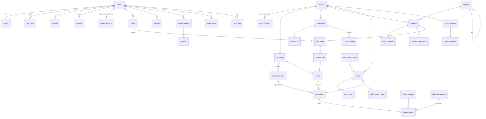

# 03 — Modelo inicial de dados e integrações

**Convenções [Recomendação]:**
- PostgreSQL. Chaves `uuid` (v7, ordenáveis no tempo). Timestamps `timestamptz` em UTC.
- **Dinheiro em inteiro de centavos (`bigint`) + `currency char(3)`** — nunca `float`.
- **Percentuais em pontos-base** (`bps`, 2500 = 25,00%) — inteiros, sem arredondamento binário.
- Exclusão lógica (`deleted_at`) para entidades de conteúdo; **nenhuma exclusão** em tabelas financeiras e de auditoria (permissão de `UPDATE/DELETE` revogada no banco para o papel da aplicação).
- Toda tabela com `created_at`, `updated_at`; entidades editáveis por admin têm histórico via `audit_logs`.

## 1. Diagrama entidade-relacionamento (MVP)

## 2. Entidades e restrições importantes

### Identidade e acesso
| Tabela | Campos principais | Restrições / notas |
|---|---|---|
| `users` | id, email (citext), email_verified_at, password_hash (argon2id), status (`active`,`suspended`,`deleted`), last_login_at | `UNIQUE(email)`; se usar provedor de auth gerenciado, esta tabela espelha o ID externo |
| `profiles` | user_id PK/FK, display_name, username, avatar_url, bio, social_links jsonb, birth_year? | `UNIQUE(lower(username))`; dados **públicos**: display_name, username, avatar, bio |
| `user_roles` | user_id, role (`user`,`operator`,`admin`,`brand_rep`), brand_id?, granted_by | **Ajustado na Fase 3:** o mapeamento papel → permissões fica versionado em código (`src/modules/access/permissions.ts`), não em tabelas; ver doc 08 |
| `sessions` | id, user_id, created_at, expires_at, ip_hash, user_agent, revoked_at | IP armazenado como hash com *salt* rotativo |
| `consents` | user_id, document (`terms`,`privacy`,`rewards_rules`), version, accepted_at | Histórico; nunca sobrescrever |
| `payout_accounts` | user_id, pix_key_type, pix_key_enc, cpf_enc, holder_name_enc, verified_at | **Criptografia em nível de campo**; coletado só no 1º resgate |

### Marcas, campanhas e regras
| Tabela | Campos | Restrições |
|---|---|---|
| `brands` | id, name, slug, status, website, legal_name, cnpj, contract_ref, contract_signed_at | `UNIQUE(slug)` |
| `campaigns` | id, brand_id, name, starts_at, ends_at, status (`draft`,`active`,`ended`) | |
| `commission_rules` | id, campaign_id, version, **base_type** (`item_gross`,`item_net_discounts`,`item_net_discounts_freight`… — enumeração a fechar após contrato), **commission_bps**, **user_share_bps**, **platform_share_bps**, attribution_window_days, validation_days, eligibility_policy jsonb, valid_from, valid_to, approved_by, approved_at | `CHECK(user_share_bps + platform_share_bps = commission_bps)`; `EXCLUDE` para não haver vigências sobrepostas na mesma campanha; **imutável após aprovação** (nova versão em vez de editar) |

> Com os números do adendo: `commission_bps = 2500`, `user_share_bps = 2000`, `platform_share_bps = 500` — **cadastrados como dado, não como código**, em estado `draft` até a confirmação contratual.

### Catálogo
| Tabela | Campos | Restrições |
|---|---|---|
| `categories` | id, parent_id, name, slug | árvore simples |
| `products` | id, brand_id, external_id (ID na loja), sku_ref, title, description, category_id, external_category, url, image_urls jsonb, price_cents, sale_price_cents, currency, availability (`in_stock`,`out_of_stock`,`discontinued`), attributes jsonb (cor, material, gênero), status, last_seen_at, content_hash | `UNIQUE(brand_id, external_id)`; índices: GIN `tsvector` (busca em português, `unaccent`), `(brand_id, status)`, `(category_id, price_cents)` |
| `product_variants` | id, product_id, external_sku, size, color, availability | `UNIQUE(product_id, external_sku)` |
| `product_price_history` | product_id, price_cents, sale_price_cents, observed_at | para "preço mudou" |
| `integrations` | id, brand_id, type (`vtex_orders`,`product_feed`), config jsonb (sem segredos), secret_ref, status, last_success_at | segredos **apenas** no cofre (`secret_ref`) |
| `import_runs` | id, integration_id, started_at, finished_at, status, stats jsonb, error_sample jsonb | |

### Looks
| Tabela | Campos | Restrições |
|---|---|---|
| `looks` | id, user_id, title, description, slug, status (`draft`,`published`,`unpublished`,`removed`), occasion/style tags, cover_image_url, published_at, removed_reason | `UNIQUE(slug)`; slug imutável após publicação |
| `look_items` | id, look_id, product_id, position, note, **price_at_publish_cents** | `UNIQUE(look_id, product_id)`; `UNIQUE(look_id, position) DEFERRABLE`; máx. 12 itens [Recomendação] |
| `favorites` | user_id, product_id | PK composta |
| `look_reports` | look_id, reporter (nullable), reason, status | moderação |

### Rastreamento e atribuição
| Tabela | Campos | Restrições |
|---|---|---|
| `tracking_links` | id, **code** (curto, aleatório, ≥ 8 chars base62), user_id, look_id, product_id, campaign_id | `UNIQUE(code)` — 1 por (look, produto) |
| `clicks` | id, **click_id** (público, ULID), tracking_link_id, user_id, look_id, product_id, campaign_id, occurred_at, ip_hash, ua_hash, referrer_domain, is_bot, is_self_click | Particionada por mês; índice `(click_id)` único; dados mínimos (sem IP em claro) |

### Pedidos e conversões
| Tabela | Campos | Restrições |
|---|---|---|
| `inbound_events` | id, integration_id, source, **external_event_id**, payload_hash, payload jsonb (sem dados pessoais da compradora), received_at, processed_at, status, attempts, last_error | `UNIQUE(integration_id, external_event_id)` — **idempotência na entrada** |
| `orders` | id, brand_id, **external_order_id**, store_created_at, status_raw, status (normalizado), currency, items_total_cents, discounts_cents, shipping_cents, attribution_evidence jsonb, is_test | `UNIQUE(brand_id, external_order_id)`; **sem nome/e-mail/endereço da compradora** |
| `order_items` | id, order_id, external_sku, product_id?, quantity, unit_price_cents, discount_cents, returned_quantity | |
| `order_status_history` | order_id, status_raw, status, changed_at, source_event_id | append-only |
| `conversions` | id, order_id, click_id, user_id, look_id, campaign_id, **commission_rule_id + rule_snapshot jsonb**, base_amount_cents, commission_cents, user_reward_cents, platform_cents, state, attribution_method, confidence | `UNIQUE(order_id)` (último clique; 1 beneficiária por pedido) ou `UNIQUE(order_id, order_item_id)` se a atribuição for por item — **decisão pendente** |

**Estados da conversão:** `registered` → `awaiting_confirmation` → `in_validation` → `approved` | `canceled` | `partially_reversed`.

### Financeiro (livro-razão de partidas dobradas)
| Tabela | Campos | Restrições |
|---|---|---|
| `ledger_accounts` | id, type (`user_rewards_pending`, `user_rewards_eligible`, `user_rewards_payout_in_progress`, `user_rewards_paid`, `brand_commission_receivable`, `brand_commission_received`, `platform_revenue_estimated`, `platform_revenue_confirmed`, `adjustments`…), owner_type, owner_id | Uma conta por (tipo, dono) |
| `ledger_transactions` | id, **idempotency_key**, kind (`conversion_registered`,`conversion_approved`,`reward_eligible`,`order_canceled`,`partial_return`,`payout_requested`,`payout_paid`,`payout_rejected`,`manual_adjustment`…), source_type, source_id, reason, created_by, approved_by, occurred_at | `UNIQUE(idempotency_key)` |
| `ledger_entries` | id, transaction_id, account_id, amount_cents (±), currency, conversion_id?, metadata | **Soma das partidas de cada transação = 0** (validado por trigger); append-only |

**Saldos** são *views* (ou materializações recalculáveis) = `SUM(amount_cents)` por conta. Não existe campo "saldo" editável.

| Tabela | Campos | Restrições |
|---|---|---|
| `payout_requests` | id, user_id, amount_cents, status (`requested`,`under_review`,`approved`,`rejected`,`paid`,`failed`), requested_at, reviewed_by, reviewed_at, reject_reason | 1 solicitação aberta por usuária |
| `payouts` | id, payout_request_id, method (`pix`), provider_ref, paid_at, receipt_url, executed_by | `UNIQUE(provider_ref)` |
| `brand_invoices` | id, brand_id, period_start, period_end, amount_cents, status (`draft`,`issued`,`paid`,`partially_paid`,`overdue`,`canceled`), external_ref | itens apontam para conversões |
| `brand_invoice_items` | invoice_id, conversion_id, amount_cents | `UNIQUE(conversion_id)` — conversão faturada uma só vez |
| `brand_payments` | id, invoice_id, amount_cents, received_at, method, bank_ref, registered_by | |
| `reconciliation_runs` / `reconciliation_items` | execução, pedido, tipo de divergência, valores esperado×observado, status (`open`,`explained`,`adjusted`), resolution_note | Toda divergência é investigável |

### Transversais
| Tabela | Notas |
|---|---|
| `notifications` | user_id, type, payload, read_at, channel (in-app/e-mail) |
| `audit_logs` | actor_id, actor_role, action, entity_type, entity_id, before jsonb, after jsonb (com campos sensíveis mascarados), ip_hash, occurred_at — append-only, retenção longa |
| `settings` | chave/valor versionados (mínimo de resgate, janela de atribuição padrão) |
| `contact_messages` | formulário de contato, retenção curta |

## 3. Classificação dos dados

| Classe | Exemplos | Acesso |
|---|---|---|
| **Público** | Looks publicados, perfil público, produtos ativos, marcas | Qualquer pessoa |
| **Privado (da usuária)** | E-mail, rascunhos, cliques/vendas/recompensas próprios, sessões | Titular + admin (auditado) |
| **Sensível financeiro** | CPF, chave PIX, comprovantes | Titular + admin financeiro; criptografado |
| **Administrativo** | Regras comerciais, contratos, faturas da marca, auditoria, divergências | Admin (operador parcial) |
| **Técnico** | Payloads de integração (minimizados), logs | Admin/engenharia; retenção curta |

**Minimização:** não armazenar dados pessoais da compradora final; IP/UA apenas em hash; data de nascimento só se necessária para comprovar maioridade (alternativa: autodeclaração).

## 4. Índices, integridade, migrações, backups
- FKs com `ON DELETE RESTRICT` em tudo que é financeiro; `CASCADE` apenas em filhos de conteúdo (ex.: `look_items`).
- Índices para os filtros do admin: `conversions(state, campaign_id, created_at)`, `ledger_entries(account_id, created_at)`, `orders(brand_id, store_created_at)`, `clicks(look_id, occurred_at)`.
- Migrações versionadas no repositório (ferramenta de migração do ORM), revisadas em PR, aplicadas por CI em homologação antes de produção; migrações **aditivas** (expandir → migrar → contrair).
- Backups: PITR (recuperação para ponto no tempo) diário com retenção ≥ 7–30 dias + dump lógico semanal em armazenamento separado; **teste de restauração trimestral**.

## 5. Integrações necessárias

| Integração | Finalidade | Mecanismo [a validar] | Status |
|---|---|---|---|
| **Feed de produtos Suntime (XML)** | Catálogo | Download agendado (ex.: a cada 6 h) + importação manual; upsert por `external_id`; produtos ausentes → `out_of_stock`/`discontinued` | **[Pendente]** receber XML real |
| **VTEX — pedidos** | Pedidos, status, cancelamentos | OMS API (consulta de pedido) + notificações de mudança de status (Orders Feed/Hook) — ver doc 05 | **[Pendente]** auditoria de acesso |
| **VTEX — atribuição** | Relacionar pedido ↔ `click_id` | Candidatos: `marketingData` (UTMs/utmi) do orderForm, `customData`, app de afiliados, cupom individual | **[Pendente]** teste E2E |
| **E-mail transacional** | Verificação, recuperação, notificações | Provedor (Resend/Postmark/SES) | Decisão técnica |
| **Armazenamento de imagens** | Avatares, capas de looks | Object storage + CDN; imagens de produto servidas pela CDN da marca ou espelhadas (decidir por direito de uso) | Decisão técnica |
| **Pagamentos PIX às usuárias** | Resgates | MVP: manual com comprovante; v1: API de PSP para pagamentos em lote | **[Pendente]** decisão financeira |
| **Antiabuso** | Cadastro/login/cliques | CAPTCHA invisível (Turnstile) + rate limit | Decisão técnica |
| **Observabilidade** | Erros, logs, alertas | Sentry + logs estruturados + alertas | Decisão técnica |
| **Analytics de produto** | Funil, uso | Ferramenta com respeito a consentimento (PostHog/Plausible) | Decisão técnica |
