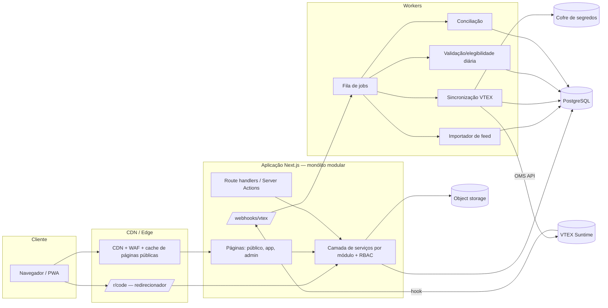

# 04 — Arquitetura técnica recomendada

## 1. Princípio: monólito modular, proporcional ao estágio

Para um MVP com uma marca e volume inicial baixo, a recomendação é **um único aplicativo web (monólito modular) + banco relacional + fila de jobs**, com fronteiras de módulo bem definidas. Isso reduz custo e complexidade operacional e permite extrair serviços (ex.: rastreamento de cliques, integrações) quando houver necessidade real.



## 2. Escolhas de tecnologia e justificativas

| Camada | Recomendação | Por quê | Alternativas consideradas |
|---|---|---|---|
| Linguagem | **TypeScript** ponta a ponta | Tipos compartilhados entre front, back e validação; um só ecossistema para a equipe | — |
| Framework web | **Next.js (App Router)** | SSR/SSG para SEO e prévia de compartilhamento das páginas de look; Server Components reduzem JS no celular; rotas de API no mesmo projeto | Remix; SPA + API separada (pior SEO/OG, mais infra) |
| UI | **Tailwind CSS + componentes acessíveis (Radix UI/shadcn)** | Design system por *tokens*, primitivas acessíveis (foco, ARIA) | MUI (mais pesado, visual genérico) |
| Banco | **PostgreSQL** gerenciado (Supabase ou Neon) | Transações ACID para o razão, constraints, RLS, busca textual em português, JSONB | MySQL; NoSQL (inadequado para financeiro) |
| ORM / migrações | **Drizzle ORM** (ou Prisma) | SQL explícito, migrações versionadas, bom suporte a constraints | Prisma (ótimo DX, menos controle de SQL avançado) |
| Validação | **Zod** | Mesmo esquema no formulário (cliente) e no servidor | Yup |
| Formulários | **React Hook Form + Zod** | Performance e acessibilidade | — |
| Estado no cliente | **TanStack Query** para dados do servidor; **Zustand** apenas no montador | Evita estado global desnecessário | Redux (excessivo) |
| Autenticação | **Auth.js (NextAuth) com sessões no banco** ou **Supabase Auth** | E-mail/senha + Google, verificação, recuperação; MFA TOTP para admin | Clerk (custo/lock-in, dados fora do país) |
| Jobs/filas | **Inngest** ou **pg-boss** (fila no próprio Postgres) | Retentativas, *backoff*, agendamento (cron), idempotência; sem operar Redis no MVP | BullMQ + Redis |
| Imagens | Object storage (Supabase Storage / Cloudflare R2) + `next/image` | Redimensionamento, WebP/AVIF, CDN | — |
| Hospedagem | **Vercel** (app) + Postgres gerenciado em região **São Paulo** (`sa-east-1`) | Deploy por PR, previews, CDN global; latência baixa no Brasil | Railway/Render/Fly; AWS (mais controle, mais ops) |
| Segredos | Variáveis de ambiente criptografadas do provedor; credenciais VTEX no **cofre** (ex.: Supabase Vault / Doppler) | Nunca no repositório; rotação | — |
| Observabilidade | **Sentry** (erros e performance) + logs estruturados (JSON) + alertas | Diagnóstico rápido | Datadog (caro para o estágio) |
| Testes | **Vitest** (unitários/serviços), **Testing Library** (componentes), **Playwright** (E2E) | Padrão do ecossistema | Jest/Cypress |
| CI/CD | **GitHub Actions**: lint, typecheck, testes, migração em homologação; deploy automático | — | — |

> **Decisão a confirmar com o negócio:** Supabase (Postgres + Auth + Storage + Vault em um lugar, menos peças) vs. Neon + Auth.js + R2 (mais portável). Recomendo **Supabase** pela simplicidade operacional no MVP, usando o banco de forma portável (SQL padrão + migrações próprias), para não depender de recursos proprietários.

## 3. Estrutura de pastas (proposta)

```
/
├─ src/
│  ├─ app/                         # Rotas (Next.js App Router)
│  │  ├─ (public)/                 # /, /looks, /l/[slug], /como-funciona, /faq...
│  │  ├─ (auth)/                   # /entrar, /cadastro, /recuperar-senha...
│  │  ├─ app/                      # Área da usuária (layout com guarda de sessão)
│  │  ├─ admin/                    # Painel (layout com guarda de papel + MFA)
│  │  ├─ r/[code]/route.ts         # Redirecionador de cliques
│  │  └─ api/webhooks/vtex/route.ts
│  ├─ modules/                     # Domínio — regra de negócio NÃO fica em componentes
│  │  ├─ identity/                 # usuários, perfis, sessões, consentimentos
│  │  ├─ access/                   # RBAC: can(user, 'perm', resource)
│  │  ├─ catalog/                  # marcas, produtos, categorias, importador de feed
│  │  ├─ looks/                    # composição, publicação, slugs, moderação
│  │  ├─ tracking/                 # links, cliques, antifraude
│  │  ├─ orders/                   # pedidos normalizados, status
│  │  ├─ attribution/              # pedido ↔ clique
│  │  ├─ commissions/              # regras versionadas e cálculo
│  │  ├─ ledger/                   # razão de partidas dobradas, saldos
│  │  ├─ payouts/                  # resgates e pagamentos
│  │  ├─ billing/                  # faturas e recebimentos das marcas
│  │  ├─ reconciliation/
│  │  ├─ notifications/
│  │  ├─ reporting/
│  │  ├─ audit/
│  │  └─ integrations/vtex/        # cliente VTEX, mapeadores, webhooks
│  ├─ components/
│  │  ├─ ui/                       # design system: Button, Input, Card, Modal, Table...
│  │  └─ patterns/                 # ProductCard, LookCard, MoneyAmount, StatusBadge...
│  ├─ lib/                         # db, auth, logger, money, errors, env
│  └─ jobs/                        # definições de jobs e cron
├─ db/migrations/
├─ tests/ (e2e/, fixtures/ com dados FICTÍCIOS identificados)
└─ docs/
```

Cada módulo expõe uma API interna (`service.ts`) e esconde seu acesso a dados (`repo.ts`). Módulos financeiros só são alterados por meio do `ledger` (nunca escrevem saldo direto).

## 4. Back-end: módulos, responsabilidades e garantias

| Módulo | Entradas | Saídas | Regras-chave | Depende de |
|---|---|---|---|---|
| identity | cadastro, login, OAuth | sessão, perfil | senha argon2id, verificação de e-mail, bloqueio progressivo | notifications, audit |
| access | usuário + ação + recurso | permitido/negado | negar por padrão; escopo por dono/marca | — |
| catalog | feed XML | produtos normalizados | upsert idempotente por `external_id`; `content_hash` evita reprocessar; preço com histórico | integrations |
| looks | itens, metadados | look publicado + slug | ≥ 2 itens ativos para publicar; slug imutável; snapshot de preço | catalog, tracking |
| tracking | GET `/r/code` | 302 + `click_id` | grava clique antes de redirecionar (timeout curto; em falha, redireciona mesmo assim e registra erro); marca bots/autocliques | looks, campaigns |
| orders | eventos VTEX | pedido + histórico | `UNIQUE(brand, external_order_id)`; mapa de status VTEX → interno | integrations/vtex |
| attribution | pedido + evidências | conversão (ou "sem atribuição") | último clique dentro da janela; sem evidência ⇒ não atribui | tracking, orders |
| commissions | conversão + regra vigente | valores calculados | regra pela **data do clique ou do pedido** (decisão pendente); snapshot gravado; arredondamento *half-even* em centavos; usuária+plataforma = comissão | — |
| ledger | eventos de negócio | transações balanceadas | `idempotency_key` única; soma zero; append-only | — |
| payouts | solicitação | pagamento registrado | saldo elegível ≥ valor ≥ mínimo; uma aberta por vez; aprovação admin; quem aprova ≠ quem executa (quando houver equipe) | ledger, identity |
| billing | conversões aprovadas | faturas da marca, recebimentos | conversão faturada uma só vez | ledger |
| reconciliation | pedidos VTEX × razão × recebimentos | divergências | nunca corrige silenciosamente; ajuste via ledger com motivo | orders, ledger, billing |
| notifications | eventos | e-mail/in-app | preferências da usuária | — |
| reporting | dados | KPIs/CSV | métricas estimadas × confirmadas separadas | todos (leitura) |
| audit | ações administrativas | trilha | append-only, mascarar sensíveis | — |

**Prevenção de duplicação e inconsistência:**
1. Idempotência em três camadas: `inbound_events(integration, external_event_id)`, `orders(brand, external_order_id)`, `ledger_transactions(idempotency_key)` com chaves determinísticas (ex.: `conv:{id}:approved`).
2. Processamento em transação única: estado da conversão + lançamentos no razão juntos, com `SELECT … FOR UPDATE` na conversão.
3. Máquina de estados explícita: transições inválidas lançam erro (ex.: `paid` → `pending` é impossível).
4. Webhook apenas enfileira (responde 200 rápido); o worker sempre **reconsulta o pedido na API** antes de agir (a notificação não é fonte de verdade).
5. Reprocessamento seguro: qualquer evento pode ser reexecutado; o resultado é o mesmo.

**Prevenção de acesso indevido:** autorização na camada de serviço (não só na UI), IDs não sequenciais, consultas sempre filtradas pelo dono, RLS como defesa em profundidade, CSRF (Server Actions/SameSite), cabeçalhos de segurança (CSP, HSTS), validação Zod em toda entrada, sanitização de texto livre (descrições de look), uploads com verificação de tipo/tamanho.

## 5. Front-end (resumo do plano)

- **Rotas** por grupos com layouts e guardas (`middleware` para sessão; verificação de papel no servidor em cada layout/rota).
- **Renderização:** páginas públicas de look e descoberta com SSG/ISR + revalidação por tag ao publicar/editar; área logada com renderização dinâmica.
- **Comunicação:** Server Actions para mutações de formulário; route handlers para APIs consumidas por jobs/webhooks; TanStack Query para listas paginadas/infinitas.
- **Erros e carregamento:** `loading.tsx` com *skeletons*, `error.tsx` por segmento, estados vazios com ação sugerida, *toasts* para feedback, mensagens de erro em linguagem simples.
- **Acessibilidade:** WCAG 2.2 AA — contraste, foco visível, navegação por teclado no montador (alternativa a arrastar), `alt` em imagens, rótulos em formulários, respeito a `prefers-reduced-motion`.
- **Desempenho:** `next/image` com tamanhos responsivos, LCP < 2,5 s em 4G, JS mínimo nas páginas públicas, fontes com `display: swap`.
- **Compartilhamento:** `generateMetadata` + imagem OG gerada (`opengraph-image.tsx`) com colagem do look, `og:title`, `og:description`, `twitter:card`; URL canônica `https://dominio/l/{slug}`.
- **Testes:** componentes do design system, montador (adicionar/remover/reordenar/publicar), fluxos E2E (cadastro → look → publicar → clique → redirect).

## 6. Design system (direção inicial) [Recomendação — validar com marca]

- **Personalidade:** editorial, feminina sem clichê, confiante, limpa — a foto do produto é a protagonista.
- **Cores (tokens):** `--ink #1A1A1A` (texto), `--canvas #FAF7F4` (fundo creme), `--surface #FFFFFF`, `--brand #B4475A` (rosa terroso — ação primária), `--brand-ink #FFFFFF`, `--accent #2F5D50` (verde — recompensas/sucesso), `--warning #B7791F`, `--danger #B42318`, `--muted #6B6560`, `--line #E7E1DB`. Todas as combinações de texto validadas em contraste ≥ 4,5:1. Modo escuro na v1.
- **Tipografia:** títulos em serifa editorial (ex.: *Fraunces*), texto em sans legível (ex.: *Inter*); escala 12/14/16/20/24/32/40; corpo 16 px mínimo no celular.
- **Espaçamento:** escala de 4 px (4, 8, 12, 16, 24, 32, 48, 64); raio 8/12/999; sombras suaves só em elementos flutuantes.
- **Componentes:** Button (primário, secundário, ghost, destrutivo; estados hover/focus/disabled/loading), Input/Select/Textarea com erro e ajuda, Card de produto, Card de look, Badge de status (cores + texto, nunca só cor), Modal/Bottom sheet, Tabs, Table (admin, com ordenação/paginação), Toast, Skeleton, EmptyState, MoneyAmount (sempre "R$ 1.234,56" e rótulo "estimado"/"confirmado").
- **Ícones:** um único conjunto (Lucide), traço 1,5 px.

## 7. Infraestrutura e implantação

| Item | MVP |
|---|---|
| Ambientes | `development` (local + banco local/Docker), `preview` (por PR, banco de homologação), `staging` (homologação, dados fictícios), `production` |
| Banco | Postgres gerenciado em São Paulo; PITR; réplica de leitura só quando necessário |
| Segredos | Por ambiente; credenciais VTEX de produção **somente** em produção; rotação documentada |
| CI/CD | PR → lint + typecheck + testes + preview; merge em `main` → staging; promoção manual para produção com migrações aplicadas antes |
| Monitoramento | Sentry, uptime do `/r/` e do webhook, alerta de fila parada ou erros VTEX consecutivos, alerta de divergência de conciliação |
| Custos | Planos gratuitos/iniciais (Vercel Pro ~US$ 20/mês, Supabase Pro ~US$ 25/mês, Sentry free/team) — **estimativa a confirmar com preços atuais**; limites de gasto configurados |
| Escala futura | Redirecionador para edge/worker dedicado; particionamento de `clicks`; busca dedicada (Meilisearch/Typesense) quando o catálogo crescer |
