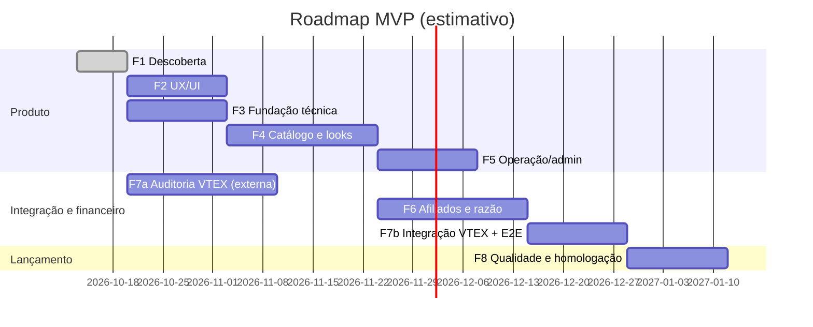

# 07 — Roadmap de implementação

Estimativas para **1–2 pessoas desenvolvedoras full stack** e servem para ordem de grandeza; serão revistas ao fim da Fase 2. As trilhas **Produto** (catálogo/looks) e **Integração** (VTEX/financeiro) correm em paralelo — a integração **não bloqueia** catálogo, montador e páginas compartilháveis.

| Fase | Entregáveis | Dependências | Critérios de aceite | Riscos | Prioridade |
|---|---|---|---|---|---|
| **1 Descoberta** | Estes documentos (`docs/01–07`) | Validação das sócias, respostas da Suntime | Sócias aprovam MVP, sitemap e decisões D1–D20 com responsáveis | Premissas de produto não validadas (D20) | P0 |
| **2 UX/UI** | Fluxos, wireframes mobile-first das telas MVP, design system (tokens + componentes), protótipo navegável | D16 (nome/identidade) | Teste com 5 usuárias: montar e compartilhar um look sem ajuda em < 3 min | Escopo visual crescer | P0 |
| **3 Fundação** | Projeto Next.js + TS, CI, banco + migrações iniciais, autenticação, RBAC, auditoria, layouts e design system em código, ambientes | D18 | Cadastro/login/recuperação funcionando; testes de autorização (usuária não acessa dado alheio; operador não acessa financeiro) passando | — | P0 |
| **4 Catálogo e looks** | Importador de feed (fictício → real), catálogo com busca/filtros, detalhe de produto, favoritos, montador, publicação, página pública com OG, perfil público, redirecionador com cliques | Feed XML real (pode iniciar com fictício) | Look publicado com URL própria mostra prévia correta no WhatsApp; clique gera `click_id` e redireciona ao produto correto; Lighthouse mobile ≥ 90 nas páginas públicas | Qualidade do feed | P0 |
| **5 Operação/admin** | Admin: visão geral, usuárias, equipe, marcas, campanhas, regras de comissão versionadas, produtos/importações, moderação, relatórios básicos, configurações | F3, F4 | Operar a plataforma sem SQL manual; toda ação registrada em auditoria | — | P1 |
| **6 Afiliados e financeiro** | Pedidos, atribuição, conversões, cálculo, livro-razão, elegibilidade, área de recompensas/extrato, resgates, faturas/recebimentos, conciliação | F5; D1–D12 para valores reais (implementação usa regras parametrizadas) | Testes automatizados: idempotência (evento repetido não duplica), soma zero do razão, cancelamento reverte, regra antiga preservada após mudança de percentual, saldo derivado = soma de lançamentos | Regras indefinidas | P0 |
| **7a Auditoria VTEX** | Checklist do doc 05 respondido, credenciais de mínimo privilégio, ambiente de teste | Suntime | Mecanismo de atribuição escolhido e documentado | Demora/indisponibilidade da marca | P0 |
| **7b Integração VTEX** | Webhook + worker + reconciliação periódica + monitoramento; roteiro E2E com 12 passos executado | F6, F7a | 12 passos do adendo comprovados com evidência; nenhuma recompensa real criada em teste | Atribuição insuficiente → plano B | P0 |
| **8 Qualidade e lançamento** | Testes E2E, revisão de segurança (OWASP ASVS nível 1), acessibilidade (WCAG AA), desempenho, termos/regulamento/privacidade revisados, runbooks, backup testado | Todas | Critérios financeiros do adendo §7 + aprovação jurídica/financeira registrada → ativar `rewards_live` | — | P0 |

**Regra de ouro:** o lançamento público do catálogo e dos looks (sem recompensas reais, com aviso "programa de recompensas em breve") pode acontecer ao fim da Fase 5, para começar a validar H1–H2 enquanto a Fase 7 é concluída — **decisão de negócio a confirmar**.

## Próxima ação imediata
1. Validar este planejamento e as decisões D1–D20 (`docs/06`).
2. Enviar à Suntime o checklist de auditoria (doc 05 §6.1) e pedir o **XML real**.
3. Definir nome/domínio (D16) e stack (D18).
4. Iniciar Fase 3 (fundação técnica) e Fase 2 (UX/UI) em paralelo.
