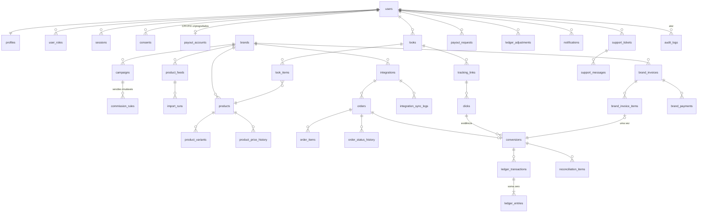

# 13 — APIs, serviços e modelo de dados

## Rotas HTTP
Especificação OpenAPI: [`docs/api/openapi.yaml`](./api/openapi.yaml). Resumo:

| Rota | Acesso | Função |
|---|---|---|
| `GET /api/produtos` | sessão | Busca do montador de looks |
| `GET /r/{code}` | público | Redirecionador de cliques |
| `GET /api/cron/importar-feeds` | Bearer `CRON_SECRET` | Importação de catálogos (6/6 h) |
| `GET /api/cron/sincronizar-pedidos` | Bearer `CRON_SECRET` | Pedidos das lojas (1/1 h) |
| `GET /api/cron/rotinas-financeiras` | Bearer `CRON_SECRET` | Conciliação + liberação (diária) |
| `GET /admin/relatorios/exportar` | `reports.export` | CSV auditado |
| `GET /app/configuracoes/exportar` | sessão | Portabilidade LGPD |
| `GET /l/{slug}/opengraph-image` | público | Imagem de compartilhamento |

## Serviços de domínio (regras de negócio no servidor)
Toda tela chama estes serviços por Server Actions, que **relêem a sessão** e passam o ator ao serviço; o serviço confere permissão (`assertCan`) e propriedade. Validação com Zod; erros esperados viram mensagens no formulário, inesperados vão ao registro de erros.

| Módulo | Arquivo | Principais operações |
|---|---|---|
| Identidade | `modules/identity/service.ts` | cadastro, confirmação, login, recuperação/troca de senha |
| Sessões | `modules/identity/sessions.ts` | criar/validar/revogar sessões |
| Equipe | `modules/identity/team.ts` | conceder/retirar papéis (mantém 1 admin) |
| Acesso | `modules/access/*` | papéis, permissões, quatro olhos |
| Catálogo | `modules/catalog/*` | importação de feed, busca, favoritos, agendamento, saúde |
| Looks | `modules/looks/service.ts` | montar, publicar, despublicar, moderar |
| Rastreamento | `modules/tracking/*` | links, cliques, destino com parâmetros |
| Comercial | `modules/commercial/service.ts` | marcas, feeds, campanhas, regras versionadas |
| Pedidos | `modules/orders/sync.ts` | sincronização idempotente, reprocessamento |
| Financeiro | `modules/finance/*` | conversões, livro-razão, elegibilidade, faturas, resgates, ajustes, conciliação |
| Integrações | `modules/integrations/admin.ts`, `src/integrations/*` | contratos, adaptadores, modos, sincronização |
| Notificações | `modules/notifications/service.ts` | notificar (idempotente), ler |
| Suporte | `modules/support/service.ts` | atendimentos e contato público |
| Privacidade | `modules/privacy/service.ts` | corrigir perfil, exportar, excluir (anonimizar) |
| Configurações | `modules/settings/service.ts` | parâmetros validados e auditados |
| Sistema | `modules/system/health.ts` | verificações de saúde |
| Auditoria | `modules/audit/*` | trilha imutável com mascaramento |

## Modelo de dados (PostgreSQL, migrações em `db/migrations`)

### Garantias implementadas no banco (além da aplicação)
| Garantia | Mecanismo |
|---|---|
| Auditoria, livro-razão e recebimentos não podem ser alterados/apagados | triggers `forbid_mutation` |
| Toda transação do livro-razão soma zero; demonstração não se mistura com real | constraint trigger diferida `ledger_entries_balanced` |
| Lançamento nunca duplicado | `ledger_transactions.idempotency_key` único |
| Pedido nunca duplicado | único `(brand_id, external_order_id)` |
| Uma conversão por pedido; uma fatura por conversão | únicos em `conversions.order_id` e `brand_invoice_items.conversion_id` |
| Usuária + plataforma = comissão | `CHECK` em `commission_rules` e `conversions` |
| Regra aprovada imutável e sem vigências sobrepostas | trigger `commission_rules_guard` + `EXCLUDE USING gist` |
| Um resgate em aberto por usuária; resgate finalizado imutável | índice único parcial + trigger |
| Mesmo CPF não recebe por duas contas | único em `payout_accounts.cpf_hash` (HMAC) |
| Dados de demonstração recusados no banco de produção | trigger `reject_demo_in_production` (com `app.environment = 'production'`) |

### Classificação de dados (LGPD)
| Classe | Onde | Proteção |
|---|---|---|
| Público | looks publicados, perfil público, catálogo | — |
| Pessoal | e-mail, sessões (IP só em HMAC), consentimentos | acesso da titular; equipe com auditoria; e-mail mascarado para operadoras |
| Sensível financeiro | CPF, chave PIX | AES-256-GCM; exibição mascarada; apagado na exclusão de conta |
| Financeiro | conversões, livro-razão, resgates | retido de forma pseudonimizada após exclusão (obrigação legal) |
| Compradoras | **não armazenado** | apenas id do pedido, itens e valores |

### Retenção (proposta, validar com jurídico)
- Sessões revogadas/expiradas e buckets de limite: limpeza periódica (job a criar).
- Contatos do site sem conta: 12 meses.
- Cliques: 24 meses (agregar depois).
- Financeiro e auditoria: prazo legal contábil/fiscal (ex.: 5 anos), pseudonimizado após exclusão.
